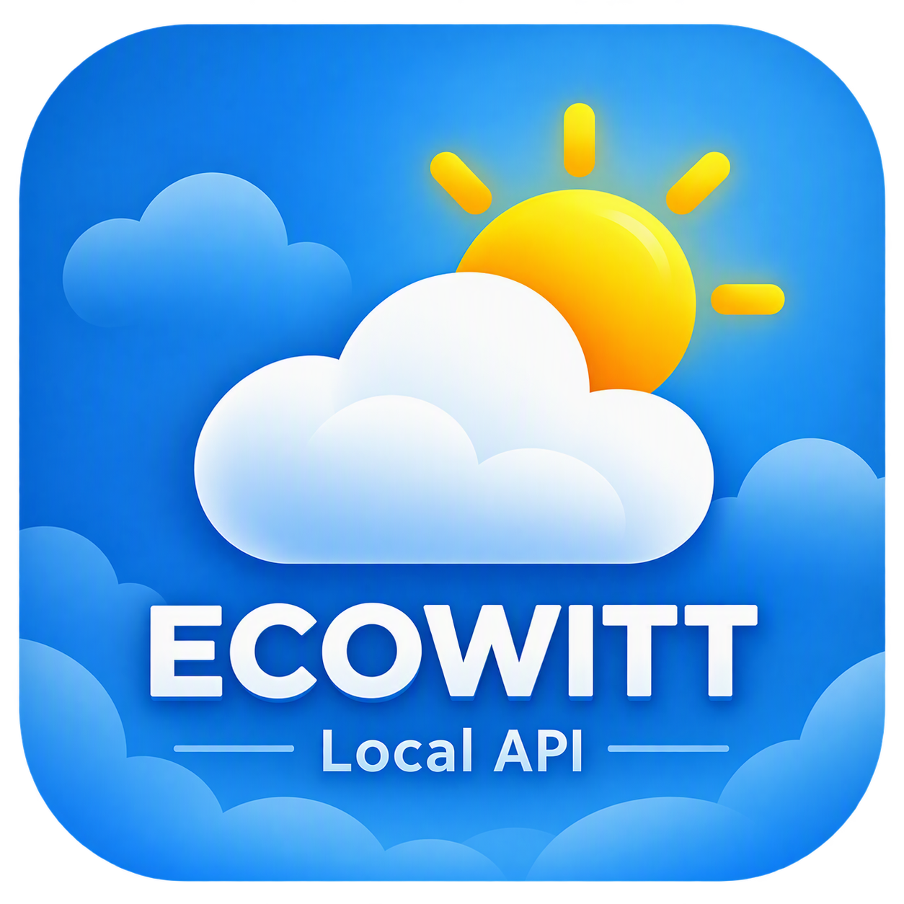

  

# Weather Gateway Live Data

Polls `http://<ip>/get_livedata_info`. IP is entered during setup.
Polling interval: number entity on the device (15–3600 s, default 60).

## Installation

### HACS (custom repository)

1. Open HACS in Home Assistant.
2. Click the three dots (top right) → **Custom repositories**.
3. Add `https://github.com/bqzero/HACS-Ecowitt-Local-API-Integration` with type **Integration**.
4. Click **Add**, then search for **Weather Gateway Live Data**.
5. Click **Download**.
6. Restart Home Assistant.

Or use this button:

### Manual

1. Download this repository.
2. Copy `custom_components/gw_livedata` into your `config/custom_components/` folder.
3. Restart Home Assistant.

## Setup

1. Go to **Settings → Devices & services → Add integration**.
2. Search for **Weather Gateway Live Data**.
3. Enter the gateway IP.